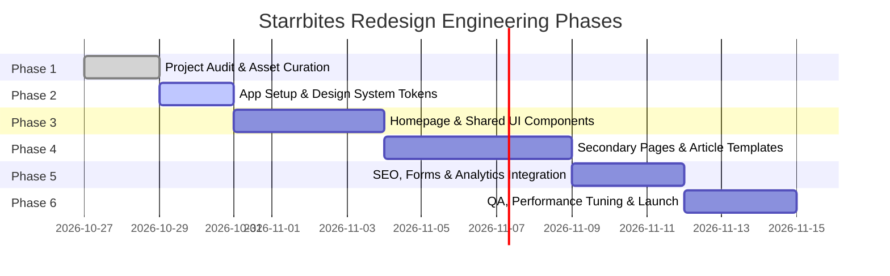

# Starrbites Website Redesign — Phased Implementation Plan

**Version:** 1.0.0  
**Date:** October 2026  
**Implementation Lead:** Senior Luxury Real Estate UI/UX Architect & Creative Technologist  
**Target Completion:** Phased Delivery  

---

## 1. Roadmap Overview & Phased Schedule

The redesign and engineering of the Starrbites web platform follows a disciplined 6-phase engineering lifecycle. Step 1 (Project Audit & Foundation) has established the visual, structural, and asset foundation.

---

## 2. Phase-by-Phase Execution Details

### Phase 1: Discovery, Audit & Asset Foundation *(Complete)*
- [x] Full filesystem audit of `D:\1. Grow Invicta\Grow Invicta\1. AI Websites\Starrbites - TT`.
- [x] Inspection and preservation of official brand logos and team portraits.
- [x] Sampling and mathematical calibration of brand colors from official logo (`#171C56` Navy, `#EDC455` Gold).
- [x] Live website audit of `starrbites.com` and `tiigertrail.com`.
- [x] Extraction and preservation of existing URL sitemap and SEO blog assets.
- [x] Curation and local downloading of 12 commercial-grade stock photographs into `public/images/stock/`.
- [x] Completion of foundational architecture and design system documentation.

### Phase 2: Application Initialization & Design System Infrastructure *(Next Step)*
- [ ] Initialize Next.js 15 (App Router) with TypeScript in non-interactive mode.
- [ ] Configure `tsconfig.json`, `next.config.ts`, and core project dependencies (`gsap`, `@gsap/react`, `lucide-react`).
- [ ] Implement `src/styles/design-tokens.css` containing all color, typography, spacing, radius, and motion tokens.
- [ ] Configure Google Fonts (`Playfair Display` + `Inter`) via `next/font/google` for zero-layout-shift (CLS = 0) and optimal font-display swap.
- [ ] Build core foundational UI primitives:
  - `<Container>` (responsive max-width wrapper)
  - `<Button>` (primary, secondary, inverted, text link)
  - `<SectionEyebrow>` (tracked uppercase labels with hairline accents)
  - `<Heading>` and `<Paragraph>` typography components
  - `<ImageReveal>` (GSAP-ready image wrapper with aspect-ratio preservation)

### Phase 3: Homepage Build & Shared Layout
- [ ] Build global `<Header>` with transparent-to-solid scroll transitions and active route highlighting.
- [ ] Build `<MobileNav>` drawer with accessible keyboard trap and thumb-friendly contact links.
- [ ] Build `<Footer>` with deep corporate navy background, official white logo, office address, and contact numbers.
- [ ] Build the 11 homepage sections in modular components:
  1. `HeroSection.tsx` — Cinematic hero with Playfair Display headline reveal.
  2. `IntroSection.tsx` — Asymmetric brand introduction.
  3. `PrinciplesSection.tsx` — 4-column numbered philosophy layout.
  4. `FlagshipSection.tsx` — Tiiger Trail showcase card and landscape backdrop.
  5. `JourneySection.tsx` — Verified company milestones timeline.
  6. `VisionSection.tsx` — Split vision and mission editorial.
  7. `AudienceSection.tsx` — 4 audience segment profiles (Investors, Second-home, Nature, NRI).
  8. `NriSection.tsx` — Overseas advisory highlights and consultation trigger.
  9. `InsightsSection.tsx` — 3 featured blog cards with image aspect ratios.
  10. `EnquirySection.tsx` — High-converting lead form with validation.
  11. Assembly in `src/app/page.tsx`.

### Phase 4: Secondary Pages & Article Templates
- [ ] **About Us (`/about-us/`):** Comprehensive company narrative, founder's message, authentic team grid (5 leaders), and expanded journey.
- [ ] **Tiiger Trail Introduction (`/tiiger-trail/`):** Flagship corporate presentation, Lepakshi growth corridor context, master plan blueprint overview, and outward link to `tiigertrail.com`.
- [ ] **NRI Investment (`/nri/`):** Due diligence guidance, FEMA compliance advisory, virtual site tour booking form.
- [ ] **Insights Journal (`/blog/` & `/blog/[slug]/`):** Editorial archive with category filtering, reading time estimates, author attribution, and rich article typography.
- [ ] **Contact Us (`/contact-us/`):** Dedicated office location map, contact cards, and multi-option enquiry form.
- [ ] **Legal Pages (`/privacy-policy/`, `/terms-and-conditions/`):** Clean editorial layout for legal notices.
- [ ] **Thank You (`/thank-you/`):** Conversion confirmation page.

### Phase 5: SEO Migration, Forms, Analytics & Integrations
- [ ] **Form Backend Processing:** Implement Next.js Server Action / API route for enquiry submissions with honeypot spam protection, server-side Zod validation, and email notification delivery.
- [ ] **Technical SEO:**
  - Automated `sitemap.ts` generating full XML sitemap.
  - Custom `robots.ts`.
  - OpenGraph & Twitter Card metadata across all routes.
  - JSON-LD Structured Data (`Organization`, `WebSite`, `Article`).
- [ ] **301 Redirect Mapping:** Configure `next.config.ts` redirects for legacy WordPress URLs.
- [ ] **Analytics Setup:** Configure Google Tag Manager (`GT-NGB743HL`) and custom GA4 conversion events (`generate_lead`, `click_to_call`, `view_tiiger_trail`, `nri_enquiry_submit`).

### Phase 6: QA, Performance Tuning & Launch
- [ ] **Responsive Visual Testing:** Verify pixel-perfection across mobile (360px, 390px), tablet (768px), laptop (1024px, 1280px), and wide desktop (1440px, 1920px).
- [ ] **Performance Validation:** Lighthouse audit targeting Scores: Performance >= 90, Accessibility >= 95, Best Practices = 100, SEO = 100. Core Web Vitals (LCP < 2.0s, CLS < 0.05, INP < 150ms).
- [ ] **Accessibility QA:** Full keyboard navigation testing (`Tab`, `Shift+Tab`, `Enter`, `Escape`), focus visibility, and screen reader verification.
- [ ] **End-to-End Form Verification:** Test lead email delivery from all enquiry entry points.

---

## 3. Motion Design & Animation Specification (GSAP 3)

Animation is critical to the luxury feel, but it must strictly adhere to performance, stability, and accessibility boundaries.

### 3.1 Animation Architecture
- **Library:** GSAP 3 with `@gsap/react` (`useGSAP` hook for safe lifecycle cleanup).
- **Plugins:** `ScrollTrigger` (lazy-loaded on client).
- **Reduced-Motion Integration:** Animations are automatically disabled or reduced to gentle opacity transitions when `prefers-reduced-motion` is detected.

### 3.2 Specific Interaction Choreography
1. **Hero Entrance Sequence:**
   - Image background: Subtle opacity fade (`0 -> 1`, 800ms) with slight scale settle (`1.05 -> 1.00`).
   - Eyebrow: `y: 20, opacity: 0 -> y: 0, opacity: 1` (400ms, delay: 200ms).
   - Display Headline: Words or lines reveal with smooth upward motion (`yPercent: 40 -> 0`, 700ms, ease: `power3.out`, delay: 350ms).
   - Supporting Lead & CTAs: Gentle fade-in (`opacity: 0 -> 1`, 500ms, delay: 650ms).
   - Total Hero Duration: Under 1.2 seconds, ensuring interactive controls are immediately usable.

2. **Scroll-Triggered Section Reveals:**
   - Elements trigger when top of element reaches 85% of viewport height (`start: "top 85%"`).
   - Uses `once: true` so content remains permanently stable after entering.
   - Text elements use modest 24px vertical offset: `y: 24, opacity: 0 -> y: 0, opacity: 1` over 600ms.
   - Feature images use subtle clip-path or scale reveal: `scale: 1.04 -> 1.00, opacity: 0.8 -> 1.0` over 800ms.

3. **Subtle Parallax (Desktop Only):**
   - Applies only to wide background images on viewports `>= 1024px`.
   - Constrained to max `±6%` displacement (`yPercent: -6 to 6`) to prevent jitter and excessive GPU paint overhead.

4. **Micro-Interactions (CSS Driven):**
   - Button hover: Background transition 200ms, border color shift to gold `#EDC455`, `translateY(-1px)`.
   - Text links: Gold hairline underline expands from `scaleX(0)` to `scaleX(1)` with `transform-origin: left` in 250ms.
   - Navigation sticky header: Background opacity transitions smoothly over 300ms upon scroll threshold.

---

## 4. Dependencies & Outstanding Approvals

Before executing Phase 2 and Phase 3, the following decisions are submitted for user review:

1. **Framework Confirmation:** Next.js 15 (App Router) + TypeScript + Vanilla CSS Design Tokens (Confirmed as optimal modern stack).
2. **Visual Direction Sign-Off:**
   - Dominant Background: White (`#FFFFFF`) with warm architectural gray (`#F6F6F4`).
   - Primary Corporate Authority: Navy (`#171C56`).
   - Precision Accent: Sampled Emblem Gold (`#EDC455`).
   - Editorial Typography: Playfair Display + Inter.
3. **Information Architecture Approval:**
   - 6-link header: `Home | About Us | Our Flagship | NRI Investment | Insights | Contact`
   - Primary CTA: `Start a Conversation`
4. **Form Routing:** Confirmation of target email inbox for lead notifications (defaulting to configured client email `iamchethandm@gmail.com` or corporate contact).
