# Starrbites Website Architecture & Sitemap

**Version:** 1.0.0  
**Date:** October 2026  
**Document Purpose:** Structural definition of pages, user journeys, navigation states, and internal content relationships.  

---

## 1. Information Architecture Overview

The Starrbites digital platform is structured to serve two complementary strategic goals:
1. **Corporate Institutional Credibility:** Presenting Starrbites as a trusted, design-conscious land developer in Bangalore with verified leadership, strict legal due diligence, and long-term legacy value.
2. **Flagship Showcase & Conversion:** Introducing **Tiiger Trail** with high editorial luxury, validating its regional infrastructure positioning, and directing serious buyers to site tours or its dedicated project platform (`tiigertrail.com`).

```mermaid
graph TD
    A[Starrbites Homepage /] --> B[About Us /about-us/]
    A --> C[Flagship: Tiiger Trail /tiiger-trail/]
    A --> D[NRI Investment /nri/]
    A --> E[Insights & Journal /blog/]
    A --> F[Contact & Enquiries /contact-us/]
    
    B --> B1[Leadership & Team]
    B --> B2[Journey Timeline]
    B --> B3[Vision & Philosophy]
    
    C --> C1[Master Plan Highlights]
    C --> C2[Lepakshi Growth Corridor]
    C --> C3[Farmhouse Architecture Vision]
    C --> C4[External Project Site tiigertrail.com]
    
    D --> D1[FEMA & Ownership Advisory]
    D --> D2[Virtual Site Exploration]
    D --> D3[NRI Consultation Form]
    
    E --> E1[Article: Farmland Verification 2025]
    E --> E2[Article: Land Mutation Rules]
    E --> E3[Article: Bengaluru Growth Corridors]
    
    F --> F1[Direct Phone & Email]
    F --> F2[Office: Dollars Colony Bangalore]
    F --> F3[Lead Capture Router]
    
    F3 --> G[Thank You /thank-you/]
```



---

## 2. Master Sitemap & URL Directory

| Page Name | Redesign URL | Priority | Core Purpose & Primary CTA |
| :--- | :--- | :--- | :--- |
| **Home** | `/` | Critical | Brand authority, flagship highlight, audience routing. *CTA: Discover Starrbites / Explore Tiiger Trail* |
| **About Starrbites** | `/about-us/` | Critical | Origin story, founder's vision, core team, verified milestones. *CTA: Start a Conversation* |
| **Our Flagship: Tiiger Trail** | `/tiiger-trail/` | Critical | Flagship introduction, location connectivity, master plan vision. *CTA: Schedule Site Visit / Project Website* |
| **NRI Investment** | `/nri/` | High | Remote advisory, documentation due diligence, virtual tours. *CTA: Request NRI Consultation* |
| **Insights & Journal** | `/blog/` | High | Editorial knowledge hub, land purchase guides, SEO authority. *CTA: Read Articles / Filter by Category* |
| **Individual Article** | `/blog/[slug]/` | High | Long-form reading, schema markup, cross-links to projects. *CTA: Book Advisory / Related Insights* |
| **Contact Us** | `/contact-us/` | Critical | Office address, verified phones, multi-category enquiry form. *CTA: Submit Enquiry* |
| **Privacy Policy** | `/privacy-policy/` | Required | Indian digital compliance, data handling, cookie policies. |
| **Terms & Conditions** | `/terms-and-conditions/` | Required | Corporate terms, disclaimer of financial/investment guarantees. |
| **Thank You** | `/thank-you/` | Supporting | Lead conversion tracking (GA4 `generate_lead`), next step expectation. |

---

## 3. Global Header & Navigation System

### 3.1 Desktop Navigation Bar
- **Positioning:** Fixed/Sticky (`z-index: 100`).
- **Initial Hero State (Top of Page):**
  - Background: Fully transparent or subtle dark scrim.
  - Logo: `Starrbites White Logos.png` (`height: 44px; aspect-ratio: 500/190`).
  - Text Links: Pure white `#FFFFFF` with smooth transition.
  - CTA Button: Inverted outline (`border: 1px solid rgba(255,255,255,0.7); color: #FFFFFF`).
- **Scrolled State (Past 80px):**
  - Background: Solid White `#FFFFFF`.
  - Border: Bottom hairline `1px solid #E7E7E7`.
  - Logo: `Starrbites Logos.png` (Navy & Gold, `height: 44px`).
  - Text Links: Corporate Navy `#171C56`.
  - CTA Button: Solid Navy `#171C56` with `#FFFFFF` text.
- **Menu Hierarchy:**
  1. `Home` → `/`
  2. `About Us` → `/about-us/`
  3. `Our Flagship` → `/tiiger-trail/` *(Highlighted with subtle gold dot indicator)*
  4. `NRI Investment` → `/nri/`
  5. `Insights` → `/blog/`
  6. `Contact` → `/contact-us/`
  7. **Action Button:** `Start a Conversation` → `/contact-us/`

### 3.2 Mobile Navigation System
- **Header Viewport:** Compact 68px height with official logo on left and accessible hamburger toggle on right.
- **Drawer State:** Full-screen slide-down or fade overlay in solid White or Deep Navy `#171C56`.
- **Contents:**
  - Large serif navigation links (24px Playfair Display).
  - Quick-dial direct contact numbers (`+91 97408 06357`, `+91 88611 97979`).
  - Flagship quick shortcut to Tiiger Trail.
  - Active accessibility focus trap and body-scroll lock when open.

---

## 4. Homepage Sectional Architecture (11 Sections)

The homepage is engineered as an unfolding editorial journey, taking the visitor from high-level brand philosophy to concrete project realization and personal action:

### Section 01: Cinematic Hero
- **Objective:** Immediate emotional and visual impact.
- **Copy:**
  - Eyebrow: `THOUGHTFULLY PLANNED LAND DESTINATIONS`
  - Headline (Display Serif): `Building Land. Creating Legacy.`
  - Lead: `We create thoughtfully planned land destinations that bring together investment potential, purposeful development, and possibilities for a more meaningful future.`
  - Actions: Primary `Discover Starrbites` (`#about-us`), Secondary `Explore Tiiger Trail` (`/tiiger-trail/`).
- **Visual:** Full-screen architectural twilight villa (`hero-contemporary-villa.jpg`) with subtle slow ambient scale.

### Section 02: Brand Introduction (Asymmetric Split)
- **Objective:** Establish the definition of Starrbites.
- **Headline (H2 Serif):** `Land is more than an asset. It is the beginning of something lasting.`
- **Content:** Bangalore-rooted development philosophy, strategic location curation, infrastructure readiness.
- **Visual:** Off-center architectural facade (`architecture-modern-facade.jpg`) with gold micro-eyebrow.

### Section 03: Philosophy & Principles (The Four Anchors)
- **Objective:** Demonstrate rigorous development principles.
- **Layout:** 4-column numbered editorial sequence with fine gold dividing lines:
  1. `01 / Purposeful Planning` — Thoughtful land organisation and master planning.
  2. `02 / Strategic Perspective` — Growth corridors, infrastructure connectivity, regional economics.
  3. `03 / Transparency & Trust` — Rigorous title deeds, clear mutation records, client guidance.
  4. `04 / Lasting Value` — Intergenerational wealth preservation and lifestyle utility.

### Section 04: Flagship Development: Tiiger Trail
- **Objective:** Principle project spotlight.
- **Headline (H2 Serif):** `Tiiger Trail — Where Nature and Soul Meet`
- **Content:** The flagship nature estate at the Karnataka–AP border. Countryside tranquility meets high-growth regional potential.
- **Visual:** Expansive full-width landscape image (`landscape-rolling-countryside.jpg`) with floating editorial feature card.
- **Actions:** Primary `Explore Tiiger Trail` (`/tiiger-trail/`), Secondary `Visit Project Website ↗` (`https://tiigertrail.com/`).

### Section 05: Our Journey (Verified Milestones)
- **Objective:** Proven operational depth and heritage.
- **Layout:** Horizontal scrollable desktop sequence / vertical mobile timeline.
- **Milestones:**
  - *Foundation:* Spatial design and interior architecture execution roots.
  - *Expansion:* Commercial and plotted project advisory experience.
  - *Stewardship:* Inception of curated managed plotted communities.
  - *Present:* Launch of Tiiger Trail Phase I and sustainable development standards.

### Section 06: Vision and Mission (Split Editorial)
- **Objective:** Corporate aspirations and accountability.
- **Vision:** To become a globally trusted land development brand from India, creating destinations that shape communities and generate lasting value.
- **Mission:** To develop thoughtfully planned land destinations combining transparency, purposeful design, and meaningful opportunities for modern buyers.
- **Visual:** Architectural vertical texture (`editorial-stone-light-shadow.jpg`).

### Section 07: Who We Serve (Curated Audience Segments)
- **Objective:** Personal relevance for diverse buyer personas.
- **Segments:**
  1. *Smart Investors:* Long-term asset security, strategic corridors.
  2. *Second-Home Seekers:* Private weekend retreats, wellness living.
  3. *Nature-Led Buyers:* Expansive greenery, outdoor immersion.
  4. *NRI & Global Buyers:* Transparent due diligence, remote transaction support.

### Section 08: NRI Investment Overview
- **Objective:** Global accessibility and confidence building.
- **Headline:** `A clearer way to explore land opportunities in India, wherever you are.`
- **Pillars:** Virtual site tours, parent deed scrutiny, FEMA-compliant documentation, remote consultation.
- **CTA:** `Explore NRI Investment` (`/nri/`).

### Section 09: Insights & Journal (Editorial Selection)
- **Objective:** Organic SEO authority and buyer education.
- **Selected Live Articles:**
  1. *Understanding Land Documentation & Ownership in 2025*
  2. *Evaluating High-Appreciation Farmland Corridors Near Bangalore*
  3. *How Land Mutation Rules Shape Long-Term Security*
- **Action:** `Explore All Insights` (`/blog/`).

### Section 10: Corporate Enquiry
- **Objective:** Frictionless conversion.
- **Headline:** `Let's discuss what you're looking to build for the future.`
- **Form:** Name, Email, Phone, Enquiry Subject, Optional Note.
- **Assurance:** No spam, guaranteed privacy, response within 24 business hours.

### Section 11: Global Master Footer
- **Background:** Deep Corporate Navy (`#171C56`).
- **Elements:**
  - Starrbites White Logo (`500 × 190 px`).
  - Company Brief: Curated land destinations, Bangalore headquarters.
  - Direct Address: `No. 194, 3rd Main, 13th Cross, RMV 2nd Stage, HIG Dollars Colony, Bengaluru - 560094`.
  - Phone Lines: `+91 97408 06357` / `+91 88611 97979`.
  - Legal: Copyright © 2026 Starrbites Developments, Privacy Policy, Terms & Conditions.

---

## 5. Technical Next.js App Router Structure

The recommended project repository structure for Phase 2–4:

```
src/
├── app/
│   ├── layout.tsx                (Root layout: Inter & Playfair fonts, Global Header, Global Footer)
│   ├── page.tsx                  (Homepage with 11 sections)
│   ├── about-us/
│   │   └── page.tsx              (About Starrbites, Team, Journey)
│   ├── tiiger-trail/
│   │   └── page.tsx              (Flagship Corporate Overview)
│   ├── nri/
│   │   └── page.tsx              (NRI Investment & Advisory)
│   ├── blog/
│   │   ├── page.tsx              (Journal Archive & Category Filter)
│   │   └── [slug]/
│   │       └── page.tsx          (Dynamic Article Template with Schema)
│   ├── contact-us/
│   │   └── page.tsx              (Interactive Contact Form & Map)
│   ├── privacy-policy/
│   │   └── page.tsx              (Privacy Documentation)
│   ├── terms-and-conditions/
│   │   └── page.tsx              (Terms of Service)
│   ├── thank-you/
│   │   └── page.tsx              (Lead Conversion Confirmation)
│   ├── sitemap.ts                (Dynamic XML Sitemap generator)
│   └── robots.ts                 (Dynamic Robots.txt generator)
├── components/
│   ├── layout/
│   │   ├── Header.tsx            (Responsive, Transparent-to-Solid Sticky)
│   │   ├── Footer.tsx            (Navy & Gold Master Footer)
│   │   └── MobileNav.tsx         (Accessible Fullscreen Drawer)
│   ├── sections/                 (Isolated homepage section modules)
│   │   ├── HeroSection.tsx
│   │   ├── IntroSection.tsx
│   │   ├── PrinciplesSection.tsx
│   │   ├── FlagshipSection.tsx
│   │   ├── JourneySection.tsx
│   │   ├── VisionSection.tsx
│   │   ├── AudienceSection.tsx
│   │   ├── NriSection.tsx
│   │   ├── InsightsSection.tsx
│   │   └── EnquirySection.tsx
│   └── ui/                       (Reusable design system primitives)
│       ├── Button.tsx
│       ├── SectionEyebrow.tsx
│       ├── Container.tsx
│       ├── FormInput.tsx
│       └── ImageReveal.tsx
├── content/                      (Structured JSON / Markdown content)
│   ├── articles/                 (Preserved blog articles)
│   └── team.json                 (Verified leadership data)
├── lib/
│   ├── animations.ts             (GSAP & ScrollTrigger setup utilities)
│   └── metadata.ts               (SEO & OpenGraph helpers)
└── styles/
    ├── globals.css               (CSS Variables, Typography, Resets)
    └── design-tokens.css         (Spacing, Breakpoints, Utility Classes)
```
